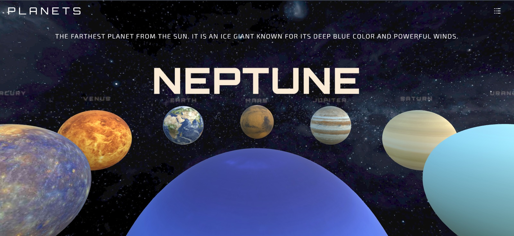

# 🌌 3D Universe Explorer

An interactive, web-based 3D Solar System exploration web application built with modern 3D rendering technologies. Explore planets, learn fascinating facts, and navigate through space seamlessly.



---

## ✨ Features

- **Interactive 3D Orbiting Models**: Real-time rendering of planets in our solar system (Mercury, Venus, Earth, Mars, Jupiter, Saturn, Uranus, Neptune).
- **Planet Information & Details**: Click or focus on a planet to display dynamically updating descriptions and space facts.
- **Smooth Navigation**: High-performance camera controls for panning, zooming, and switching focused celestial bodies.
- **Responsive & Modern UI**: Built with a sleek, futuristic space theme and responsive layout.

---

## 🛠️ Tech Stack

- **Frontend**: HTML5, CSS3, JavaScript (ES6+)
- **3D Graphics**: Three.js / WebGL
- **Styling**: Modern CSS3 / Tailwind CSS

---

## 🚀 Quick Start & Installation

1. **Clone the repository:**

   ```bash
   git clone https://github.com/HuzaiFaRz/3D-Universe.git
   ```

2. **Navigate into the project directory:**

   ```bash
   cd 3d-universe
   ```

3. **Run locally:**
   - Open `index.html` directly in your web browser, or start a local live server (e.g., using VS Code's **Live Server** extension or `npx serve`).

---

## 📂 Project Structure

```text
3d-universe/
├── public/
│   ├── font/
│   └── textures/       # Planet textures (Earth, Mars, Jupiter, etc.)
├── css/
│   └── style.css
├── js/
│   └── main.js         # 3D Scene setup, lighting, and animation loops
├── index.html
├── preview.png         # Preview screenshot for README
└── README.md
```

---

## 🤝 Contributing

Contributions, issues, and feature requests are welcome!  
Feel free to check out the [issues page](https://github.com/huzaifarz/3d-universe/issues).

1. Fork the Project
2. Create your Feature Branch (`git checkout -b feature/AmazingFeature`)
3. Commit your Changes (`git commit -m 'Add some AmazingFeature'`)
4. Push to the Branch (`git push origin feature/AmazingFeature`)
5. Open a Pull Request

---

## 📜 License

Distributed under the MIT License. See `LICENSE` for more information.
